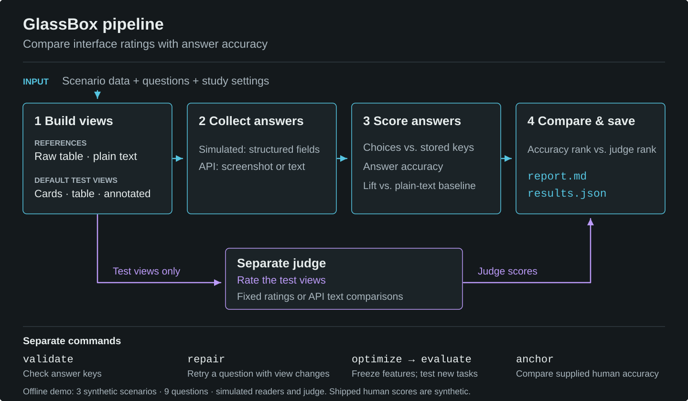

# GlassBox

GlassBox renders the same numeric data in different layouts and scores multiple-choice
answers against scenario keys. A separate judge ranks the interfaces.



The core uses Python 3.9+ and the standard library. Chrome is optional for screenshots.

## Install and verify

Run these commands from the repository root:

```sh
python3 -m venv .venv
. .venv/bin/activate
python -m pip install .
bash scripts/verify.sh
glassbox study --config offline_demo --out outputs/demo
```

Verification runs tests, recomputes answer keys, and checks offline commands without an
API key or browser. Installation bundles scenarios and prompts. Commands write Markdown
reports and JSON results to the selected output directory.

## Fixture results

The offline demo has three synthetic scenarios, nine questions, five conditions, and
three simulated readers: 135 scored answers. Readers and the default judge follow fixed
rules; these fixtures do not measure human or model comprehension or preference.

<picture>
  <source media="(prefers-color-scheme: dark)" srcset="docs/img/divergence-dark.svg">
  
</picture>

| Interface | Simulated judge score | Accuracy lift | Answer accuracy |
|---|---:|---:|---:|
| Cards | 0.62 | −59 percentage points | 4% |
| Table | 0.29 | +30 percentage points | 93% |
| Annotated | 0.76 | +33 percentage points | 96% |

Values are averaged over scenarios and readers, then rounded for display. Lift subtracts
plain-text baseline accuracy. Raw-data accuracy is recorded as `ceiling`; it is not an upper
bound or an arithmetic-skill control. [Figure data](docs/img/figures.json) contains the
underlying numbers.

## Interfaces

The [loan fixture](src/glassbox/_data/scenarios/loans.json) computes total cost as monthly
payment times term, plus fees. Cards emphasize advertised totals; the table includes
the inputs and computed cost; annotated cards sort by cost and highlight its minimum.


Run `python3 docs/make_assets.py` to regenerate the figures. PNGs need Chrome; charts
use the offline study. SciPy is optional in tests for statistical cross-checks.

## Other commands

```sh
glassbox run --readers simulated --skip-render --judge pairwise --out outputs/pairwise
glassbox repair --scenario loans --reader simulated:literal --skip-render --out outputs/repair
glassbox anchor --set fixture --skip-render --out outputs/anchor
glassbox optimize --readers simulated --scenarios loans,plans --skip-render --out outputs/selection
glassbox evaluate --selection outputs/selection/selection.json --scenarios growth --out outputs/evaluation
```

`optimize` writes in-sample reports and `selection.json`; another search needs a new output
directory. `evaluate` requires `--scenarios` and scores frozen features without search.
Readers and rendering default to the saved selection unless overridden. Overlap guards
reject recorded scenario IDs, task content, and source data; they do not verify earlier
exposure outside the saved selection set.

Use `glassbox <command> --help` for options. Live readers use `anthropic:<model>`,
`openai:<model>`, or `openrouter:<model-slug>` with the corresponding `ANTHROPIC_API_KEY`,
`OPENAI_API_KEY`, or `OPENROUTER_API_KEY` environment variable. Check model IDs and
availability with the provider. Live calls need network access and may incur charges.

Set `GLASSBOX_CHROME` to the Chrome executable outside its default macOS location.
`--skip-render` uses structured values for simulated readers and text for API readers.
Text runs do not evaluate visual layout. The default judge remains simulated even
with live readers; API pairwise judges compare interface text, not screenshots. Pairwise
judges compare both orders. Invalid replies and abstentions receive no credit; scores use
accepted comparisons only, with coverage reported. Missing scores and ranks are undefined.

Search selects and scores features on the same questions. Frozen evaluation on the shipped
synthetic data is a pilot, not proof of generalization. Human anchor values are synthetic.
Training plans are unrun; no trainer is included. Live providers and human validation
remain unevaluated.

[Architecture](docs/ARCHITECTURE.md) · [Measurement protocol](docs/PROTOCOL.md) ·
[MIT License](LICENSE)
