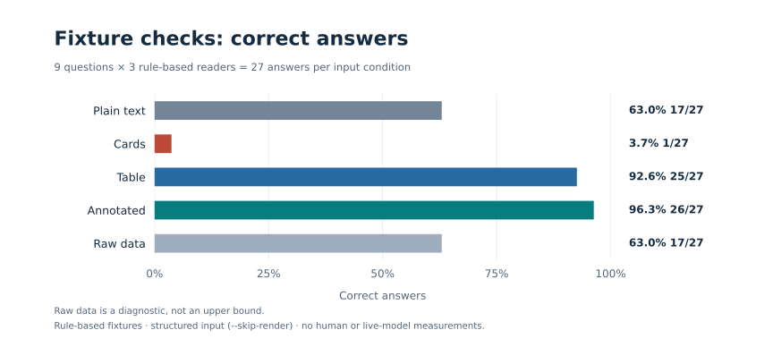
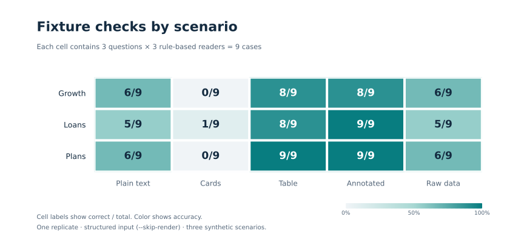
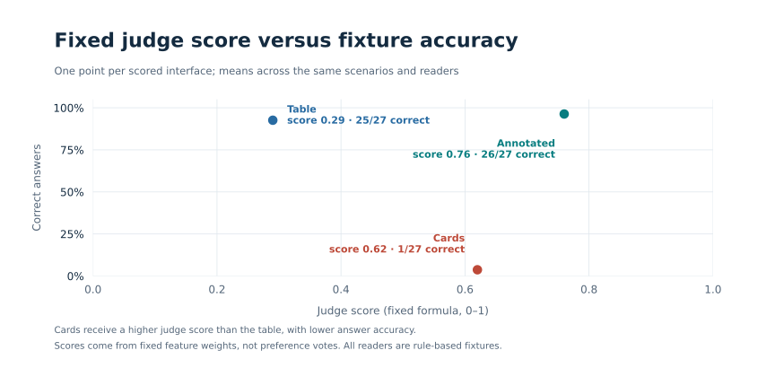
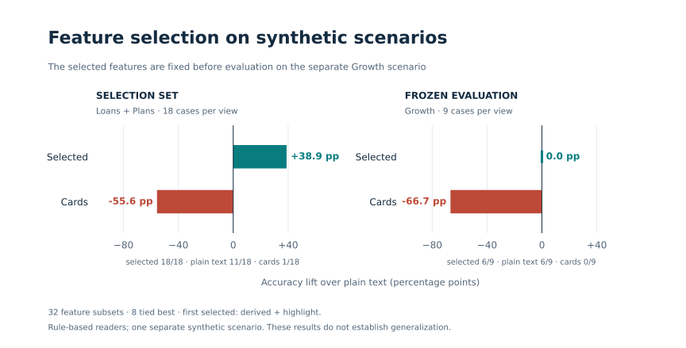
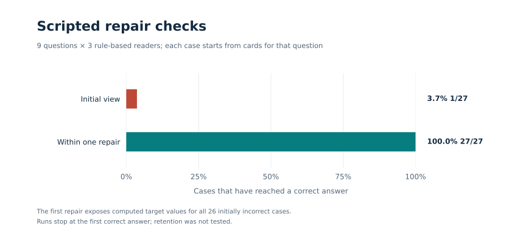

# GlassBox

GlassBox compares interface ratings with answer accuracy. It presents the same source
data as cards, a table, or an annotated view, then scores multiple-choice responses
against the scenario’s answer key.

The offline demo covers loan offers, phone plans, and revenue growth. Three rule-based
readers answer questions using the values each view exposes. A separate synthetic
judge rates the views, showing where its rankings and answer accuracy disagree.

Feature selection compares view settings, including computed values, highlights, and
sorting. Choices can be frozen and tested on separate scenarios. Study runs save a
Markdown report and scored answers in YAML.

**Keywords:** Interface evaluation · Comprehension · Pairwise judging · Feature selection

## Pipeline


[Full-size diagram](docs/img/pipeline.svg) · [Edit in Figma](https://www.figma.com/board/0Hzi29Tu1WkqLkY0tkT6nQ/GlassBox-pipeline?node-id=4-65)

<details>
<summary>Structure</summary>

```text
src/glassbox/
  core.py          Data, views, readers, rendering
  evaluation.py    Scoring, studies, reports
  __main__.py      Command-line entry point
  _data/           Scenarios, study settings, anchors
assets/results/    Charts and verified figure data
docs/img/          Pipeline and interface screenshots
scripts/verify.sh  Offline checks
tests/             Core, readers, workflows
```

</details>

## Run

Python 3.9+, from the repository root. The bundled readers and judges run offline.
Chrome is optional for screenshots.

```bash
python3 -m pip install -r requirements.txt
bash scripts/verify.sh
cd src
python3 -B -m glassbox study --config offline_demo --out ../outputs/demo
```

Outputs: `outputs/demo/report.md` and `outputs/demo/results.yaml`.

## Results

**Deterministic fixture checks · 9 questions · 3 reader rules · 5 conditions · 135 answers**











Same [loan data](src/glassbox/_data/scenarios/loans.yaml), three views. Total cost is
monthly payment × term + fees.

| View | Preview |
|---|---|
| Cards |  |
| Table |  |
| Annotated |  |

## Tech Stack

| Role | Tools |
|---|---|
| Core | Python 3.9+, standard library |
| Views | HTML/CSS; Chrome for optional PNG screenshots |
| Data and reports | YAML (PyYAML), Markdown |
| Repository charts | SVG assets |
| Checks | unittest |

## Roadmap

- [ ] Add independently authored scenarios for held-out evaluation.
- [ ] Record screenshot-based human evaluations with study settings.
- [ ] Collect human accuracy and preference data to replace synthetic anchors.

## References

1. Cleveland & McGill (1984). [Graphical Perception](https://www.tandfonline.com/doi/full/10.1080/01621459.1984.10478080).
2. Heer & Bostock (2010). [Crowdsourcing Graphical Perception](https://idl.uw.edu/papers/crowdsourcing-graphical-perception).
3. Zheng et al. (2023). [Judging LLM-as-a-Judge with MT-Bench and Chatbot Arena](https://arxiv.org/abs/2306.05685).
4. Spearman (1904). [The Proof and Measurement of Association between Two Things](https://www.jstor.org/stable/1412159).

## License

[MIT](LICENSE)
