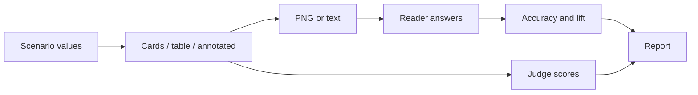
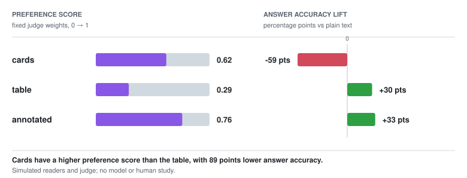
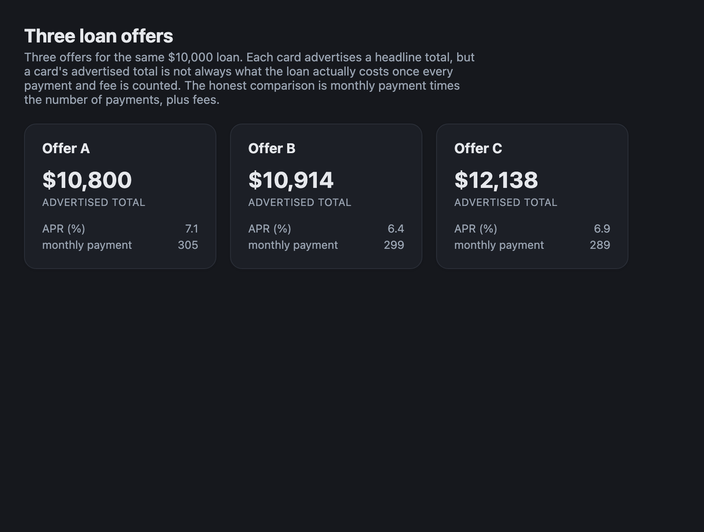
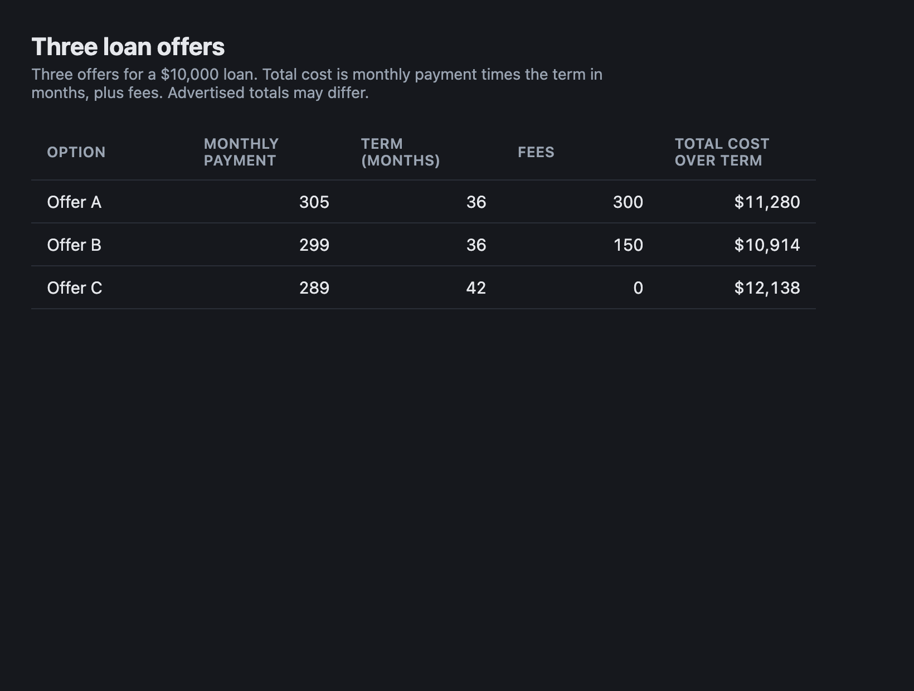
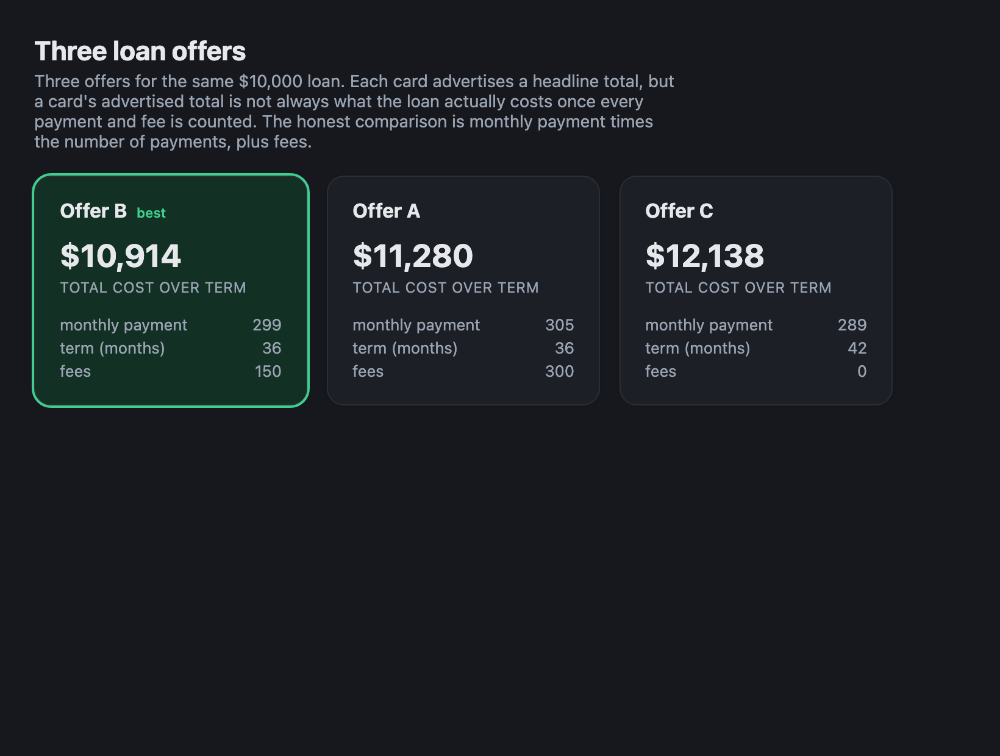

# GlassBox

GlassBox compares question accuracy across interfaces built from the same numeric data.
It renders each layout, collects multiple-choice answers, and scores them against
computed keys. A separate judge scores the interfaces for ranking comparisons.

The core uses Python 3.9+ and the standard library. Chrome is optional for screenshots.

## Pipeline



## Verify

```sh
bash scripts/verify.sh
python3 -m pip install .
glassbox study --config offline_demo --out outputs/demo
```

The verification script needs no API key or browser. It runs tests, recomputes answer
keys, and checks offline commands. Installation includes the scenarios and prompt files.
Runs write Markdown reports and JSON results to the selected output directory.

## Fixture results

The offline demo has three synthetic scenarios and nine questions. Three simulated
readers answer each question under five conditions, producing 135 scored answers.
Both the readers and default judge follow fixed rules. These results test the pipeline;
they do not measure human or model comprehension or preference.

<picture>
  <source media="(prefers-color-scheme: dark)" srcset="docs/img/divergence-dark.svg">
  
</picture>

| Interface | Simulated judge score | Accuracy lift | Answer accuracy |
|---|---:|---:|---:|
| Cards | 0.62 | −59 percentage points | 4% |
| Table | 0.29 | +30 percentage points | 93% |
| Annotated | 0.76 | +33 percentage points | 96% |

Values are averaged over scenarios and readers, then rounded. Accuracy lift is the
difference from the plain-text baseline. Raw-data accuracy is also recorded under the
historical field name `ceiling`; it is not an upper bound or an arithmetic-skill control.
The [figure data](docs/img/figures.json) records the underlying numbers.

## Interfaces

The [loan fixture](src/glassbox/_data/scenarios/loans.json) computes total cost as monthly
payment times term, plus fees. Cards emphasize advertised totals; the table includes
the inputs and computed cost; annotated cards sort by cost and highlight its minimum.





Run `python3 docs/make_assets.py` to regenerate the figures. PNGs need Chrome; charts
use the offline study. SciPy is optional in tests for statistical cross-checks.

## Other commands

```sh
glassbox run --readers simulated --skip-render --judge pairwise --out outputs/pairwise
glassbox repair --scenario loans --reader simulated:literal --skip-render --out outputs/repair
glassbox anchor --set fixture --skip-render --out outputs/anchor
glassbox optimize --readers simulated --skip-render --out outputs/search
```

Use `glassbox <command> --help` for options. Live reader specifications are
`anthropic:<model>`, `openai:<model>`, or `openrouter:<model-slug>`, with the corresponding
`ANTHROPIC_API_KEY`, `OPENAI_API_KEY`, or `OPENROUTER_API_KEY` environment variable.
Model IDs and availability must be checked with the provider. Live calls need network
access and may incur charges.

Set `GLASSBOX_CHROME` to the Chrome executable outside its default macOS location.
`--skip-render` uses structured values for simulated readers and text for API readers.
Text runs do not evaluate visual layout. The default judge remains simulated even
with live readers; API pairwise judges compare interface text, not screenshots.

Feature search selects and evaluates on the same questions. Human anchor values are
synthetic. Training files describe unrun plans; no trainer is included. Live providers
and human validation have not been evaluated here.

[Architecture](docs/ARCHITECTURE.md) describes the code and folders.
[Measurement protocol](docs/PROTOCOL.md) defines the metrics and evaluation conditions.
Licensed under the [MIT License](LICENSE).
