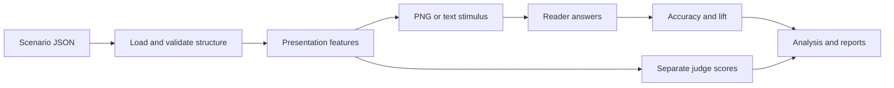

# GlassBox architecture

GlassBox builds several presentations of the same numeric data, collects multiple-choice
answers, and compares accuracy with reference conditions. A separate judge ranks the
interfaces. The [README](../README.md) covers setup and commands; the
[measurement protocol](PROTOCOL.md) defines how to interpret the results.

## Data flow

`Presentation` records visible values, item order, labels, emphasis, and highlighting.
HTML and text rendering use those fields. `Stimulus` adds the input kind, text, optional
image path, and renderer metadata.

API readers receive the screenshot and question, or interface text when rendering is
skipped. Simulated readers use the structured presentation fields. Sharing a presentation
keeps selected values consistent; offline scores do not establish that those values are
readable in an image.

## Code and content

The runtime uses Python 3.9+ and the standard library. The wheel includes scenarios,
prompts, and configuration files under `glassbox/_data/`. Commands using built-in names
work outside the checkout. SciPy is optional for statistical test comparisons; no model
training library is used.

| Path | Responsibility |
|---|---|
| `src/glassbox/_data/scenarios/` | Three synthetic tasks, nine questions, source values, and authored keys |
| `src/glassbox/_data/prompts/` | Reader and pairwise judge templates |
| `src/glassbox/_data/studies/` | Saved study settings |
| `src/glassbox/_data/anchors/` | Supplied per-question human accuracy; the shipped values are synthetic |
| `src/glassbox/_data/training/` | Unrun training declarations |
| `docs/make_assets.py`, `docs/img/` | Figure generation and committed visual assets |
| `scripts/verify.sh`, `tests/` | Offline verification and regression tests |
| `outputs/` | Default location for command results |

Modules under `src/glassbox/` are organized around the evaluation steps:

| Modules | Responsibility |
|---|---|
| `resources.py`, `_config.py` | Packaged content, explicit configuration files, and input guards |
| `schema.py`, `compute.py`, `validate.py` | Scenario structure, restricted arithmetic, and answer-key recomputation |
| `interfaces.py` | Feature presets, question-specific presentations, HTML, and text |
| `stimuli.py`, `render.py` | Reader input and staged Chrome screenshots |
| `output_paths.py` | Check output destinations and protect input/source files |
| `readers/base.py`, `readers/simulated.py` | Reader contract and deterministic fixture behavior |
| `readers/anthropic.py`, `readers/openai_compat.py`, `readers/_http.py` | Provider requests, image encoding, response extraction, and HTTP errors |
| `readers/__init__.py`, `families.py` | Reader selection and model-family identity heuristics |
| `prompts.py`, `answer_parsing.py` | Prompt templates and conservative option-letter parsing |
| `scoring.py`, `studies.py` | Collect repeated answers, calculate metrics, and execute saved studies |
| `judge.py`, `analysis.py` | Independent judge scores, ranking reversals, and correlations |
| `repair.py`, `anchor.py`, `reward.py`, `training.py` | Question-specific repair, human accuracy comparison, feature search, and training checks |
| `report.py`, `cli.py`, `__main__.py` | Markdown/JSON outputs and command-line entry points |

## Input contracts

A scenario contains `id`, `title`, `domain`, `description`, `data`, and `questions`.
`data.items` holds labeled numeric records. `data.derived` maps field names to arithmetic
expressions. Questions specify an operation, choices with machine-readable values, and
an authored correct choice. See the [loan task](../src/glassbox/_data/scenarios/loans.json)
for a complete example.

Supported operations select a minimum, maximum, or rank, or count values above/below a
threshold. Derived expressions accept numeric constants, field names, unary signs, and
`+ - * / // %`. Calls, attributes, indexing, and exponentiation are excluded. Expressions
use raw item fields rather than chaining derived fields.

Structure checks enforce typed fields, finite numeric inputs, supported operations,
unique identifiers, and consistent item choices. Run `glassbox validate` separately to
recompute answers after changing data. These checks establish consistency with the supplied values and formulas; they
do not verify external facts or establish that a question measures human understanding.

Study configurations select readers, scenarios, interface presets, replicate count,
judge, and rendering mode. Unknown fields, duplicate selections, malformed reader
specifications, and invalid boolean or integer settings are rejected before execution.
JSON configuration loading rejects duplicate keys and nonfinite numbers.

`resources.py` reads built-in files through `importlib.resources`. A configuration source
such as `offline_demo` resolves to packaged content. Explicit paths load external files;
a missing explicit path fails rather than falling back to a packaged file. External
scenario directories use the same scenario schema through the Python loading functions.

## Presentations and rendering

Named interfaces are feature sets:

| Preset | Visible fields and layout |
|---|---|
| `raw` | All raw fields in a table |
| `baseline` | All raw fields as text |
| `cards` | Headline field and selected context fields in cards |
| `table` | Detail fields and the computed primary metric |
| `annotated` | Detail fields and primary metric in sorted cards, with the selected extreme highlighted |

Scenario presentation settings select the primary metric, headline field, detail fields,
and sorting direction. Optional field display settings supply labels and units for other
metrics. A question-specific presentation uses that question's field and operation.
Rank questions can highlight their requested rank; count questions do not highlight an
individual item.

If Chrome is unavailable or `--skip-render` is set, API readers use text and simulated
readers use structured fields. In that mode, the two reference presets expose the same
values without their different visual layouts. A text run does not evaluate typography,
spacing, or visual prominence.

Chrome captures use an isolated temporary profile and staged HTML/PNG files. The renderer
checks capture completion and validates PNG structure, dimensions, compressed rows, and
checksums before replacing the destination. It records natural exit or confirmed capture
followed by controlled shutdown. Failed captures preserve an existing destination.

Output checks reject source-tree destinations and planned symlink, hardlink, or input-file
collisions. Rendering uses fixed viewport and scale settings, but system fonts and color
scheme can still change pixels across machines. PNG validation establishes a complete
image file; it does not establish that every field fits in the viewport.

## Readers, judges, and provenance

Readers implement `answer(scenario, question, stimulus)` and return an `Answer`. API
requests contain the visible stimulus, question, and choices rather than the answer key.
Keys are read from the corresponding provider environment variable at request time.
The adapters support Anthropic Messages and OpenAI-compatible Chat Completions, including
OpenRouter routing. Model availability and request-format compatibility require provider
verification.

The simulated personas use fixed rules. `literal` compares visible target values or falls
back to the emphasized field. `diligent` also computes derived targets when their inputs
are visible. `careless` can select the runner-up for close extrema unless a matching
highlight is present. These are test fixtures, not fitted models of reader behavior.

The default judge assigns fixed polish weights. Pairwise results aggregate wins over the
selected presets. API pairwise judges compare interface text and ask for perceived
comprehension; their scores do not measure objective question accuracy or human aesthetic
preference. Ambiguous reader replies count as incorrect; unparseable pairwise replies
count as ties.

`families.py` records provider and model separately. It resolves known model-name prefixes
into model families, so the same family can be grouped across providers. Unknown labels
remain unresolved and do not establish independent families. This heuristic does not
verify shared training data, model availability, or independence.

Study results retain per-question answers and raw API replies, reader identity, simulation
status, selected variants, and renderer information. Provenance includes scenario
snapshots and hashes, packaged prompt hashes, loaded-template hashes, actual reader-prompt
hashes, stimulus-text hashes, and image hashes when available. These identify different
inputs and artifacts; a matching hash does not establish scientific validity.

## Metrics and optional workflows

Accuracy is correct answers divided by attempts. Comprehension lift subtracts plain-text
baseline accuracy. `ceiling_gap` subtracts raw-data accuracy. The historical `ceiling`
field is the raw reference's accuracy, not an upper bound or an arithmetic-skill control.
Missing cells and undefined correlations remain undefined in reports.

Replicates support repeated answers, accuracy spread, and answer stability. Ranking
analysis reports judge/accuracy reversals, Spearman correlations, and model-family
agreement. A reversal in every family may involve different pairs of interfaces; common
pairs are reported separately. See [PROTOCOL.md](PROTOCOL.md) for the measurement rules.

The offline reader accuracies below describe the fixed rules on the nine shipped
questions:

<picture>
  <source media="(prefers-color-scheme: dark)" srcset="img/accuracy-dark.svg">
  
</picture>

Repair starts with cards for the selected question. After an error, it adds the target
metric and inputs, then sorting or a question-appropriate highlight. It stops on a correct
answer, the turn limit, or no remaining change. `turns_to_understanding` records the first
correct turn, with the initial view at zero; it does not measure retained understanding.

Anchoring asks only the declared questions under the selected condition, pools answers
over readers and replicates, and compares that accuracy with supplied human values.
The shipped anchor is synthetic. A real comparison needs a documented source and matching
questions and presentation conditions; setting `is_fixture` to `false` verifies neither.

Search enumerates the 32 subsets of five generator features, or a supplied feature pool.
Each candidate and the fixed cards comparison receives a fresh plain-text baseline.
Selection and evaluation use the same scenarios and readers, with no held-out evaluation.
The `fresh_per_candidate_and_cards` metadata records that sampling protocol; stochastic
readers can produce different baselines between candidates.

Training declarations check supported method names, reward, the declared generator/base
model family, and reader-family exclusions. They do not run SFT or GRPO. An empty error
list does not verify model or framework availability, and family exclusions do not prove
resistance to answer leakage.

## Verification and extension

Run `bash scripts/verify.sh` from the checkout. It runs the unit suite with warnings treated
as errors, validates source answers, and checks offline study and repair outputs in a
temporary directory. Provider requests are mocked in tests. Optional browser contrast
checks need configured Node/Puppeteer and Chrome; SciPy comparisons run only when installed.

Add scenarios under the packaged data directory and run `validate`. Add reader adapters
through the registry with request/reply tests. New presentation flags need build/render
behavior and, if applicable, explicit additions to the search pool or repair policy.
New judges should state their criterion and input modality in metadata. Keep fixture
behavior and empirical measurements distinguishable in generated reports.
