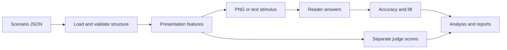
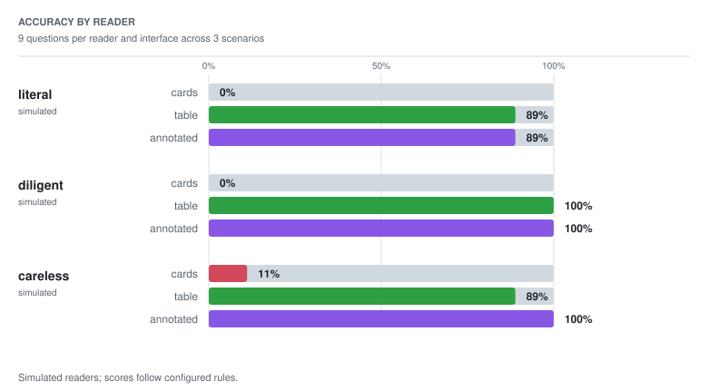

# GlassBox architecture

[README](../README.md): setup and commands.
[Measurement protocol](PROTOCOL.md): metrics and evaluation conditions.

## Data flow

`Presentation` supplies visible values, order, labels, emphasis, and highlights to both
HTML and text rendering. `Stimulus` adds input kind, text, an optional image path, and
renderer metadata. Readers receive a question with the screenshot, text, or structured
fields described below. Shared values do not establish image readability.

## Code and content

The runtime uses Python 3.9+ and the standard library. No model training library is
used. Wheels bundle scenarios, prompts, and configurations under `glassbox/_data/`, so
built-in names work outside the checkout. SciPy optionally cross-checks statistics in tests.

| Path | Responsibility |
|---|---|
| `src/glassbox/_data/scenarios/` | Three synthetic tasks, nine questions, source values, and authored keys |
| `src/glassbox/_data/prompts/` | Reader and pairwise judge templates |
| `src/glassbox/_data/studies/` | Saved study settings |
| `src/glassbox/_data/anchors/` | Supplied per-question human accuracy; the shipped values are synthetic |
| `src/glassbox/_data/training/` | Unrun training declarations |
| `docs/make_assets.py`, `docs/img/` | Figure generation and committed visual assets |
| `scripts/verify.sh`, `tests/` | Offline verification and regression tests |
| `outputs/` | Default location for command results |

Modules in `src/glassbox/`:

| Modules | Responsibility |
|---|---|
| `resources.py`, `_config.py` | Packaged content, explicit configuration files, and input guards |
| `schema.py`, `compute.py`, `validate.py` | Scenario structure, restricted arithmetic, and answer-key recomputation |
| `interfaces.py` | Feature presets, question-specific presentations, HTML, and text |
| `stimuli.py`, `render.py` | Reader input and staged Chrome screenshots |
| `output_paths.py` | Check output destinations and protect input/source files |
| `readers/base.py`, `readers/simulated.py` | Reader contract and deterministic fixture behavior |
| `readers/anthropic.py`, `readers/openai_compat.py`, `readers/_http.py` | Provider requests, image encoding, response extraction, and HTTP errors |
| `readers/__init__.py`, `families.py` | Reader selection and model-family identity heuristics |
| `prompts.py`, `answer_parsing.py` | Prompt templates and conservative option-letter parsing |
| `scoring.py`, `studies.py` | Collect repeated answers, calculate metrics, and execute saved studies |
| `judge.py`, `analysis.py` | Independent judge scores, ranking reversals, and correlations |
| `repair.py`, `anchor.py`, `reward.py`, `selection.py`, `training.py` | Repair, human accuracy comparison, feature search, frozen selections, and training checks |
| `report.py`, `cli.py`, `__main__.py` | Markdown/JSON outputs and command-line entry points |

## Input contracts

Scenarios contain `id`, `title`, `domain`, `description`, `data`, and `questions`.
`data.items` holds labeled numeric records; `data.derived` maps fields to arithmetic
expressions. Questions specify an operation, choices with machine-readable values, and
an authored correct choice. See the [loan task](../src/glassbox/_data/scenarios/loans.json).

Operations select a minimum, maximum, or rank, or count values above/below a threshold.
Derived expressions accept numeric constants, raw field names, unary signs, and
`+ - * / // %`; calls, attributes, indexing, exponentiation, and derived-field chains
are excluded.

Structure checks enforce types, finite numeric inputs, supported operations, unique IDs,
and consistent item choices. Run `glassbox validate` separately after changing data to
recompute answers. These checks establish consistency with source values and formulas, not external facts
or whether questions measure human understanding.

Studies select readers, scenarios, presets, replicates, judge, and rendering mode.
Unknown fields, duplicate selections, malformed readers, and invalid boolean/integer
settings fail before execution. JSON loading rejects duplicate keys and nonfinite numbers.

`resources.py` uses `importlib.resources` for built-in names such as `offline_demo`.
Explicit paths load external files and fail if missing, without packaged fallback.
Python loaders apply the same schema to external scenario directories.

## Presentations and rendering

Presets are feature sets.

| Preset | Visible fields and layout |
|---|---|
| `raw` | All raw fields in a table |
| `baseline` | All raw fields as text |
| `cards` | Headline field and selected context fields in cards |
| `table` | Detail fields and the computed primary metric |
| `annotated` | Detail fields and primary metric in sorted cards, with the selected extreme highlighted |

Presentation settings select the primary metric, headline and detail fields, and sort
direction. Optional field display settings supply other metrics' labels and units.
Question-specific views use the target field and operation: rank questions can highlight
the requested rank; count questions do not highlight individual items.

API readers use screenshots, or text when Chrome is unavailable or `--skip-render` is
set. Simulated readers use structured fields. Without rendering, both reference presets
expose the same values; typography, spacing, and visual prominence are not evaluated.

Chrome uses an isolated temporary profile and staged HTML/PNG files. Capture completion,
PNG structure, dimensions, compressed rows, and checksums are checked before replacement.
Metadata records natural exit or confirmed capture followed by controlled shutdown.
Failed captures preserve existing destinations.

Output checks reject source-tree destinations, symlinks, hardlinks, and input-file
collisions. Viewport and scale are fixed; system fonts and color scheme can change pixels
across machines. A complete PNG does not guarantee that every field fits the viewport.

## Readers, judges, and provenance

Readers implement `answer(scenario, question, stimulus)` and return an `Answer`. API
requests contain the visible stimulus, question, and choices, excluding the answer key.
Provider keys come from environment variables at request time. Adapters support Anthropic
Messages and OpenAI-compatible Chat Completions, including OpenRouter. Check model
availability and request-format compatibility with the provider.

Fixed reader fixtures: `literal` compares visible targets or uses the emphasized field;
`diligent` also computes derived targets from visible inputs; `careless` can choose the
runner-up for close extrema without a matching highlight. These rules are not fitted
models of reader behavior.

The default judge uses fixed polish weights. Pairwise judges compare both orders of each
selected pair: six comparisons for three views. API judges compare text for perceived
comprehension, not objective accuracy or human aesthetic preference. Ambiguous reader
replies count as incorrect. Invalid judge replies and abstentions are excluded without
credit; genuine custom-judge ties receive half a point. No accepted judgments means an
undefined pairwise score and rank. Rates are conditional on accepted comparisons, so per-view
coverage is reported.

`meta.judge.evidence` in `results.json` retains per-scenario comparison order, outcomes,
raw replies, and prompt hashes. `valid_count` includes genuine ties; `tie_count` is its
subset. Invalid and abstained counts remain separate.

`families.py` records provider and model separately and groups known model-name prefixes
across providers. Unknown labels remain unresolved. These name heuristics do not verify
model availability, shared training data, or independence.

Study results retain per-question answers, raw API replies, reader identity, simulation status,
variants, and renderer information. Provenance includes scenario snapshots and hashes, packaged
prompt hashes, loaded-template hashes, actual reader-prompt hashes, stimulus-text hashes,
and image hashes when available. These identify distinct inputs and artifacts, not scientific
validity.

## Metrics and optional workflows

Accuracy is correct answers divided by attempts. Comprehension lift subtracts plain-text
baseline accuracy. `ceiling_gap` subtracts raw-data accuracy. The historical `ceiling`
field is the raw reference's accuracy, not an upper bound or an arithmetic-skill control.
Missing cells and undefined correlations remain undefined in reports.

Replicates show accuracy spread and answer stability. Analysis reports judge/accuracy
reversals, Spearman correlations, and model-family agreement. Families may reverse different
interface pairs; common pairs are reported separately. Ranks omit nonfinite scores; correlations use finite
paired observations. Cross-family preference requires finite scores in every selected scenario.
See [PROTOCOL.md](PROTOCOL.md).

Fixture accuracy on the nine shipped questions:

<picture>
  <source media="(prefers-color-scheme: dark)" srcset="img/accuracy-dark.svg">
  
</picture>

Repair starts with cards for one question. After an error, it adds the target metric and
inputs, then sorting or a question-appropriate highlight. It stops on a correct answer, the turn limit,
or no remaining change. `turns_to_understanding` is the first correct turn (initial view
zero), not retained understanding.

Anchoring asks declared questions under the selected condition and pools accuracy over
readers and replicates for comparison with supplied human values. The shipped anchor is
synthetic. Real comparisons need a documented source and matching questions and presentation
conditions; `is_fixture` set to `false` verifies neither.

Search enumerates 32 subsets of five generator features, or a supplied pool. Each candidate
and the cards comparison gets a fresh plain-text baseline. Its reported selection scores
use the same scenarios and readers. `fresh_per_candidate_and_cards` records this protocol;
stochastic baselines may differ between candidates.

`optimize` also creates `selection.json`, storing frozen features, selection scenarios,
reader settings, rendering mode, protocol identifiers, and hashes. Creation is exclusive: use a new
output directory for another search. `evaluate --selection ... --scenarios ...` applies
those features without search; explicit scenarios are required. Reader/render settings
are inherited unless overridden. Evaluation writes `evaluation.md` and `evaluation.json`,
shares one baseline between selected and cards views per scenario, and weights scenarios
equally.

Evaluation rejects overlap by scenario ID, task fingerprint, or source-data fingerprint.
Disjointness covers the recorded selection set, not external prior access or arbitrary
semantic copies. Results using the shipped fixtures remain a synthetic pilot, not evidence
of generalization.

Training declarations check method names, reward, generator and base model families, and reader
family exclusions. They do not run SFT or GRPO or verify model or framework availability; passing
family checks does not prove resistance to answer leakage.

## Verification and extension

`bash scripts/verify.sh` runs unit tests with warnings as errors, validates source answers,
and checks offline study, repair, selection, and evaluation outputs in a temporary directory.
Run it from the checkout.
Provider requests are mocked. Optional browser contrast checks need configured
Node/Puppeteer and Chrome; SciPy comparisons require SciPy to be installed.

Add scenarios to packaged data and run `validate`. Register reader adapters with
request/reply tests. New presentation flags need build/render behavior and explicit
search-pool or repair-policy additions where applicable. Judge metadata should state the
criterion and modality. Label fixture and empirical results distinctly.
